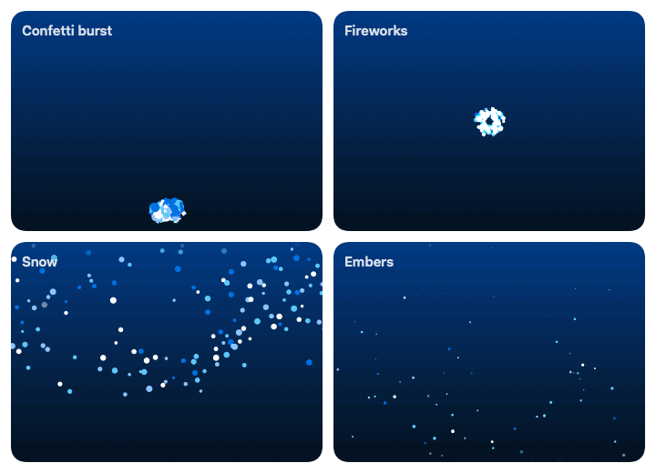
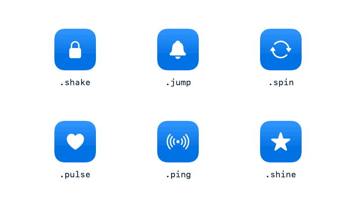
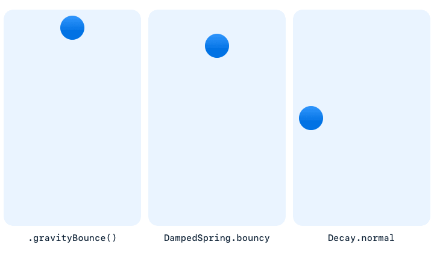
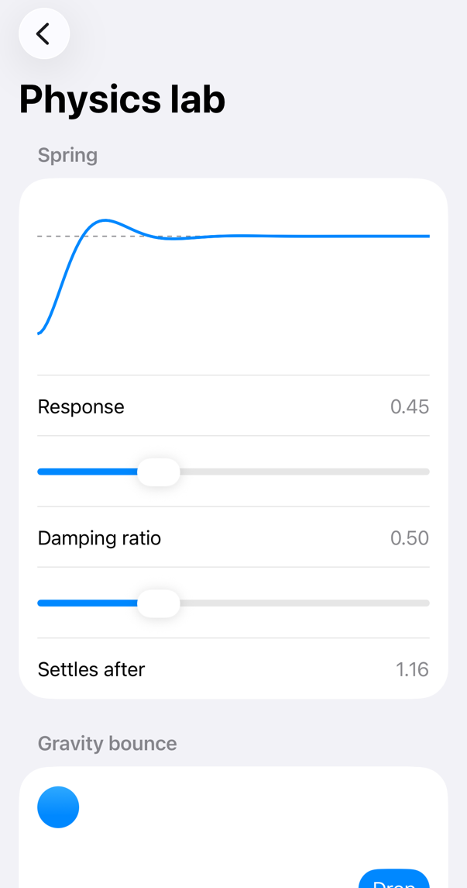
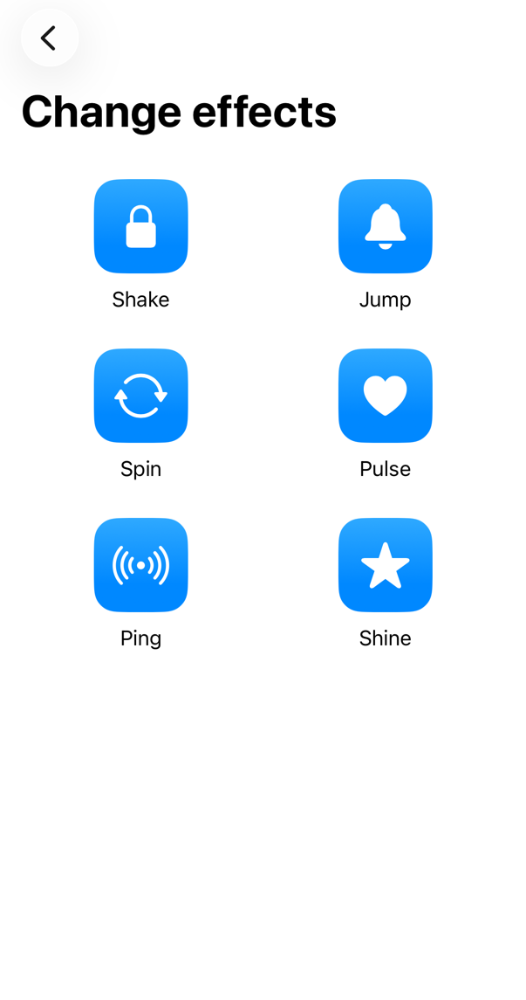
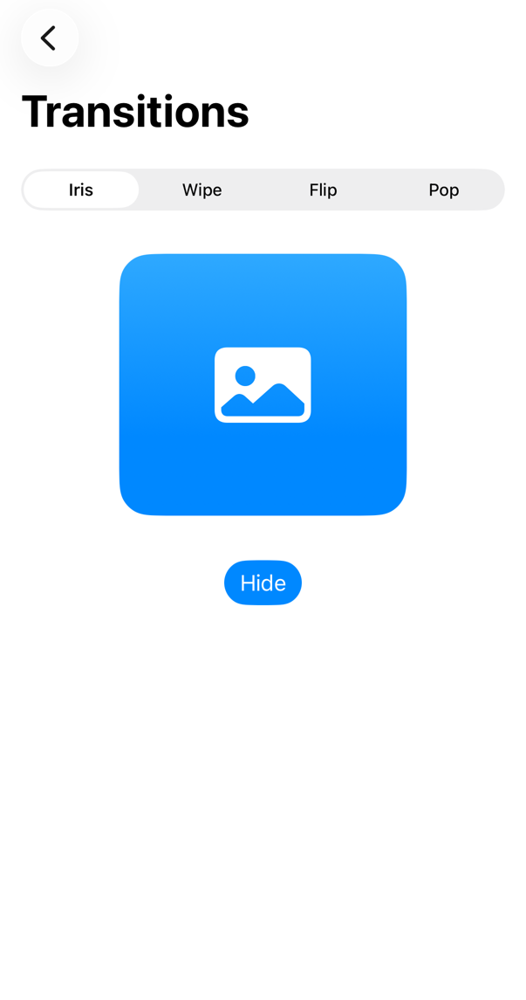
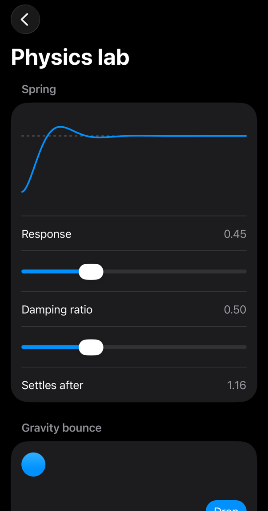
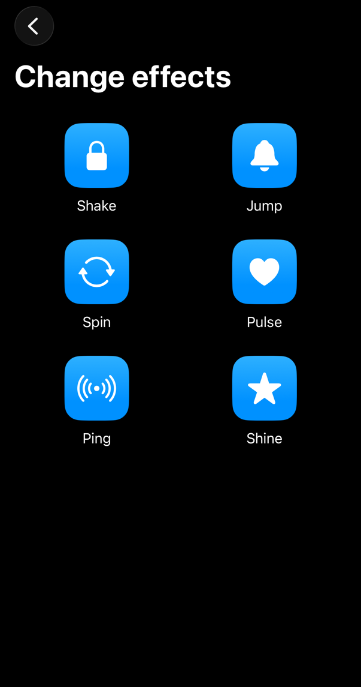
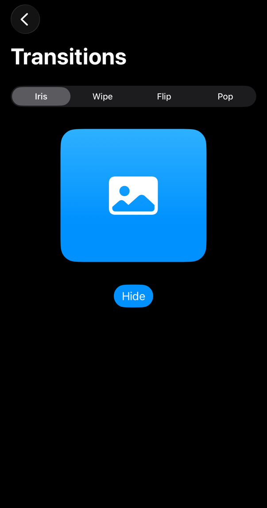

<!-- i18n-source: README.md@62c98af62b79b6ced607674090d5935e44c1ed97 status=reviewed -->
<!-- brand:start -->

<p align="center"><picture><source media="(prefers-color-scheme: dark)" srcset="https://raw.githubusercontent.com/muhittincamdali/SwiftUI-Animation-Masterclass/main/.github/brand/banner-zh-CN-dark.svg"><source media="(prefers-color-scheme: light)" srcset="https://raw.githubusercontent.com/muhittincamdali/SwiftUI-Animation-Masterclass/main/.github/brand/banner-zh-CN-light.svg"></picture></p>

<!-- lang-selector:start -->
<p align="center"><a href="README.md">English</a> · <a href="README.tr.md">Türkçe</a> · <a href="README.zh-CN.md">简体中文</a> · <a href="README.ja.md">日本語</a> · <a href="README.ko.md">한국어</a> · <a href="README.es.md">Español</a> · <a href="README.de.md">Deutsch</a> · <a href="README.fr.md">Français</a> · <a href="README.pt-BR.md">Português (Brasil)</a> · <a href="README.ru.md">Русский</a></p>
<!-- lang-selector:end -->

<p align="center">
<a href="https://github.com/muhittincamdali/SwiftUI-Animation-Masterclass/actions/workflows/ci.yml"></a>
<a href="https://github.com/muhittincamdali/SwiftUI-Animation-Masterclass/releases"><picture><source media="(prefers-color-scheme: dark)" srcset="https://raw.githubusercontent.com/muhittincamdali/SwiftUI-Animation-Masterclass/main/.github/brand/badge-version-dark.svg"><source media="(prefers-color-scheme: light)" srcset="https://raw.githubusercontent.com/muhittincamdali/SwiftUI-Animation-Masterclass/main/.github/brand/badge-version-light.svg"></picture></a>
<a href="https://github.com/muhittincamdali/SwiftUI-Animation-Masterclass/blob/main/Package.swift"><picture><source media="(prefers-color-scheme: dark)" srcset="https://raw.githubusercontent.com/muhittincamdali/SwiftUI-Animation-Masterclass/main/.github/brand/badge-platforms-dark.svg"><source media="(prefers-color-scheme: light)" srcset="https://raw.githubusercontent.com/muhittincamdali/SwiftUI-Animation-Masterclass/main/.github/brand/badge-platforms-light.svg"></picture></a>
<a href="https://github.com/muhittincamdali/SwiftUI-Animation-Masterclass/blob/main/Package.swift"><picture><source media="(prefers-color-scheme: dark)" srcset="https://raw.githubusercontent.com/muhittincamdali/SwiftUI-Animation-Masterclass/main/.github/brand/badge-language-dark.svg"><source media="(prefers-color-scheme: light)" srcset="https://raw.githubusercontent.com/muhittincamdali/SwiftUI-Animation-Masterclass/main/.github/brand/badge-language-light.svg"></picture></a>
<a href="https://github.com/muhittincamdali/SwiftUI-Animation-Masterclass/blob/main/LICENSE"><picture><source media="(prefers-color-scheme: dark)" srcset="https://raw.githubusercontent.com/muhittincamdali/SwiftUI-Animation-Masterclass/main/.github/brand/badge-license-dark.svg"><source media="(prefers-color-scheme: light)" srcset="https://raw.githubusercontent.com/muhittincamdali/SwiftUI-Animation-Masterclass/main/.github/brand/badge-license-light.svg"></picture></a>
</p>

<p align="center">
<a href="#快速开始"><picture><source media="(prefers-color-scheme: dark)" srcset="https://raw.githubusercontent.com/muhittincamdali/SwiftUI-Animation-Masterclass/main/.github/brand/button-start-zh-CN-dark.svg"><source media="(prefers-color-scheme: light)" srcset="https://raw.githubusercontent.com/muhittincamdali/SwiftUI-Animation-Masterclass/main/.github/brand/button-start-zh-CN-light.svg"></picture></a>
<a href="https://muhittincamdali.github.io/SwiftUI-Animation-Masterclass/documentation/swiftuianimationmasterclass/"><picture><source media="(prefers-color-scheme: dark)" srcset="https://raw.githubusercontent.com/muhittincamdali/SwiftUI-Animation-Masterclass/main/.github/brand/button-docs-zh-CN-dark.svg"><source media="(prefers-color-scheme: light)" srcset="https://raw.githubusercontent.com/muhittincamdali/SwiftUI-Animation-Masterclass/main/.github/brand/button-docs-zh-CN-light.svg"></picture></a>
<a href="https://github.com/muhittincamdali/SwiftUI-Animation-Masterclass/tree/main/Examples"><picture><source media="(prefers-color-scheme: dark)" srcset="https://raw.githubusercontent.com/muhittincamdali/SwiftUI-Animation-Masterclass/main/.github/brand/button-examples-zh-CN-dark.svg"><source media="(prefers-color-scheme: light)" srcset="https://raw.githubusercontent.com/muhittincamdali/SwiftUI-Animation-Masterclass/main/.github/brand/button-examples-zh-CN-light.svg"></picture></a>
</p>

> 本文是英文 README 的译文。如两者内容不一致，以英文版为准。

<!-- brand:end -->

一个适用于 iOS 17+ 和 macOS 14+ 上 SwiftUI 的 Swift 动效包：基于物理的弹簧、衰减（decay）与弹跳，能保持手指速度的拖动，以及粒子效果、变化效果和转场。它面向只想在某个界面上加一个效果、又不想引入整套框架的应用开发者：所有功能都是 view modifier、`Animation`、`Transition` 或普通的值类型，并且这个包没有任何依赖。

## 亮点

- **可直接调用的物理计算** — `DampedSpring` 以闭式解求解弹簧方程（测试会将结果与数值积分对比），`Decay` 预测一次甩动最终停在何处，`GravityBounce` 让一个值落下并弹跳，`.gravityBounce()` 则把它作为 SwiftUI 动画运行。
- **保留动量的拖动** — `.elasticDrag()` 和 `.snapDrag(_:offsets:selection:)` 会把松手时的速度传给弹簧，越过边界时产生橡皮筋式的阻力，并让一次甩动继续滑向下一个停靠位置。
- **单个 Canvas 中的粒子** — 8 种预设、5 种力和 7 种形状（包括 SF Symbols 和 emoji），全部由一个 `Canvas` 绘制；带种子的模拟在种子相同时生成相同的帧，且粒子数量永远不会超过 10,000。
- **变化效果与转场** — 值变化时播放的 shake、jump、spin、pulse、ping 和 shine 效果，以及基于 iOS 17 `Transition` 协议的 iris、wipe、flip 和 pop 转场。
- **支持“减弱动态效果”** — 该设置开启时，不绘制粒子，不播放变化效果，转场改为淡入淡出，拖动则以简短的 ease-out 收尾。
- **经过测试，Swift 6** — 在 macOS 和 iPhone 模拟器上运行 63 个 Swift Testing 测试，其中包括 NaN、无穷大和越界输入；该包可在 Swift 6 语言模式下构建。

### 内容一览

| 区域 | API |
| --- | --- |
| 物理 | `DampedSpring` (`gentle`, `snappy`, `bouncy`, `smooth`), `Decay`, `GravityBounce`, `.gravityBounce(fallDuration:restitution:)`, `RubberBand`, `SnapPoints` |
| 手势 | `.elasticDrag(axes:resistance:spring:)`, `.snapDrag(_:offsets:selection:decay:spring:)` |
| 粒子 | `.particleBurst(_:trigger:)`, `.particleEffect(_:isActive:)`, `ParticleView`, `ParticleEmitter`, `ParticleForce`, `ParticleSystem` |
| 预设 | `confetti`, `fireworks`, `snow`, `rain`, `sparkles`, `bubbles`, `hearts`, `embers` |
| 变化效果 | `.changeEffect(_:value:)` 搭配 `.shake`, `.jump`, `.spin`, `.pulse`, `.ping`, `.shine` |
| 转场 | `.iris(origin:)`, `.wipe(from:)`, `.flip(axis:)`, `.pop` |
| 滚动 | `.scrollDriven(multiplier:)` （视差） |
| 演示 | `AnimationShowcase`，一个包含每种效果各一个示例的界面 |

## 快速开始

**1. 添加软件包**

在 Xcode 中选择 **File › Add Package Dependencies…**，然后输入仓库地址：

```text
https://github.com/muhittincamdali/SwiftUI-Animation-Masterclass.git
```

把它粘贴到窗口右上角的搜索框中。将 **Dependency Rule** 保持为从 `2.0.0` 起的 **Up to Next Major Version**，然后点击 **Add Package**。在接下来的窗口中，在 **SwiftUIAnimationMasterclass** 旁边选择你的 app target，再次点击 **Add Package**。

**2. 导入模块**

```swift
import SwiftUIAnimationMasterclass
```

**3. 开始使用**

给任意 view 加上一个 modifier。这个点赞按钮每次点击都会跳动一下，并喷出一簇爱心：

```swift
import SwiftUI
import SwiftUIAnimationMasterclass

struct LikeButton: View {
    @State private var likes = 0

    var body: some View {
        Button("Like", systemImage: "heart.fill") { likes += 1 }
            .buttonStyle(.borderedProminent)
            .changeEffect(.jump(), value: likes)
            .particleBurst(.hearts, trigger: likes)
    }
}
```

如果想在写代码之前先看看所有效果，请在 `#Preview` 中放入 `AnimationShowcase()`。

## 安装

### Swift Package Manager

在 Xcode 中选择 **File › Add Package Dependencies…**，然后输入仓库地址：

```text
https://github.com/muhittincamdali/SwiftUI-Animation-Masterclass.git
```

或者将其添加到 `Package.swift` 的 `dependencies` 中：

```swift
dependencies: [
    .package(url: "https://github.com/muhittincamdali/SwiftUI-Animation-Masterclass.git", from: "2.0.0")
],
targets: [
    .target(name: "YourApp", dependencies: [
        .product(name: "SwiftUIAnimationMasterclass", package: "SwiftUI-Animation-Masterclass")
    ])
]
```

请使用 2.0.0 或更高版本：1.0.0 版本无法构建。

## 使用方法

下面的每个示例都复制自 [`ReadmeSamples.swift`](Examples/MotionGallery/MotionGallery/ReadmeSamples.swift)，示例应用和测试 target 都会编译这个文件。

### 让一个值弹跳着落下

`.gravityBounce()` 是一个 `Animation`：值落到新的目标位置，并在那里弹跳。

```swift
struct DropBadge: View {
    @State private var isDropped = false

    var body: some View {
        Image(systemName: "bell.fill")
            .font(.largeTitle)
            .offset(y: isDropped ? 0 : -120)
            .animation(.gravityBounce(restitution: 0.5), value: isDropped)
            .onAppear { isDropped = true }
    }
}
```

### 用粒子庆祝

`.particleBurst(_:trigger:)` 在每次值变化时喷发一次；`.particleEffect(_:)` 则让一个效果持续作用在 view 上。

```swift
struct OrderButton: View {
    @State private var orders = 0

    var body: some View {
        Button("Place order") { orders += 1 }
            .buttonStyle(.borderedProminent)
            .particleBurst(.confetti, trigger: orders)
    }
}

struct WinterScene: View {
    var body: some View {
        LinearGradient(colors: [.indigo, .blue], startPoint: .top, endPoint: .bottom)
            .particleEffect(.snow)
            .ignoresSafeArea()
    }
}
```

### 吸引人注意一次变化

```swift
struct PasswordField: View {
    @State private var password = ""
    @State private var failures = 0

    var body: some View {
        SecureField("Password", text: $password)
            .textFieldStyle(.roundedBorder)
            .changeEffect(.shake(), value: failures)
            .onSubmit { if password.count < 8 { failures += 1 } }
    }
}
```

### 显示和隐藏 view

这些转场与内置转场一样，配合 `if` 和 `withAnimation` 使用。

```swift
struct PhotoReveal: View {
    @State private var showsPhoto = false

    var body: some View {
        VStack {
            Button(showsPhoto ? "Hide" : "Reveal") {
                withAnimation(.smooth(duration: 0.6)) { showsPhoto.toggle() }
            }
            if showsPhoto {
                Image(systemName: "photo.artframe")
                    .font(.system(size: 120))
                    .foregroundStyle(.blue)
                    .transition(.iris(origin: .topTrailing))
            }
        }
        .frame(height: 220, alignment: .top)
    }
}
```

### 带动量的拖动

一个有两个停靠位置（detent）的上拉面板：缓慢松手会回到最近的位置，用力甩动则会滑向下一个位置。

```swift
struct PullUpPanel: View {
    @State private var detent = 1

    var body: some View {
        RoundedRectangle(cornerRadius: 24)
            .fill(.blue.gradient)
            .frame(height: 400)
            .overlay(alignment: .top) {
                Capsule().fill(.white.opacity(0.6)).frame(width: 40, height: 5).padding(10)
            }
            .snapDrag(.vertical, offsets: [0, 260], selection: $detent)
    }
}
```

### 设计你自己的粒子效果

发射器的每个参数都有默认值，所以只需设置让效果与众不同的那些：

```swift
let stardust = ParticleEmitter(
    source: .edge(.bottom),
    birthRate: 30,
    lifetime: 2...3,
    speed: 60...120,
    direction: .degrees(-90),
    spread: .degrees(20),
    size: 6...10,
    endScale: 0.3,
    forces: [.vortex(center: .center, strength: 80), .gravity(-20)],
    colors: [.white, .cyan],
    shapes: [.star],
    fadeIn: 0.1,
    blending: .additive
)
```

## 演示

由包自身的模拟与效果代码通过 [`scripts/render-readme-media.sh`](scripts/render-readme-media.sh) 逐帧渲染（粒子颜色设为蓝色调色板，与“使用方法”一节相同）：

<picture>
  <source media="(prefers-color-scheme: dark)" srcset="docs/images/particles-dark.gif">
  
</picture>

<picture>
  <source media="(prefers-color-scheme: dark)" srcset="docs/images/effects-dark.gif">
  
</picture>

<picture>
  <source media="(prefers-color-scheme: dark)" srcset="docs/images/physics-dark.gif">
  
</picture>

示例应用在 iPhone 模拟器上的界面，由 [`scripts/capture-example-screens.sh`](scripts/capture-example-screens.sh) 截取：

| 物理实验室 | 变化效果 | 转场 |
| --- | --- | --- |
|  |  |  |
|  |  |  |

想亲自体验这些效果，请用 Xcode 打开 [`Examples/MotionGallery`](Examples/MotionGallery) 中的 `MotionGallery.xcodeproj`，选择一个 iPhone 模拟器或 **My Mac**，然后点击 **Run**。详情见 [Examples/README.md](Examples/README.md)。

## 文档

API 参考文档与文章：

- [API 参考](https://muhittincamdali.github.io/SwiftUI-Animation-Masterclass/documentation/swiftuianimationmasterclass/)
  （DocC，从 `main` 分支发布到 GitHub Pages）
- 在 Xcode 中通过 **Product › Build Documentation** 在本地构建，或使用命令行：

```sh
xcodebuild docbuild -scheme SwiftUIAnimationMasterclass -destination 'generic/platform=macOS'
```

## 指南

- [Getting Started](https://muhittincamdali.github.io/SwiftUI-Animation-Masterclass/documentation/swiftuianimationmasterclass/gettingstarted)
  — 添加这个包，然后依次加入弹跳、喷发、抖动和转场
  （[源文件](Sources/SwiftUIAnimationMasterclass/SwiftUIAnimationMasterclass.docc/GettingStarted.md)）。
- [Throwing and Snapping](https://muhittincamdali.github.io/SwiftUI-Animation-Masterclass/documentation/swiftuianimationmasterclass/throwingandsnapping)
  — 拖动 modifier，以及其底层的弹簧、衰减（decay）和吸附点
  （[源文件](Sources/SwiftUIAnimationMasterclass/SwiftUIAnimationMasterclass.docc/ThrowingAndSnapping.md)）。
- [Designing Particle Effects](https://muhittincamdali.github.io/SwiftUI-Animation-Masterclass/documentation/swiftuianimationmasterclass/designingparticleeffects)
  — 预设、发射器、力、上限，以及自己驱动模拟
  （[源文件](Sources/SwiftUIAnimationMasterclass/SwiftUIAnimationMasterclass.docc/DesigningParticleEffects.md)）。
- [Respecting Reduce Motion](https://muhittincamdali.github.io/SwiftUI-Animation-Masterclass/documentation/swiftuianimationmasterclass/respectingreducemotion)
  — 该设置开启时每个效果的表现
  （[源文件](Sources/SwiftUIAnimationMasterclass/SwiftUIAnimationMasterclass.docc/RespectingReduceMotion.md)）。

## 系统要求

| 平台 | 最低版本 |
| --- | --- |
| iOS | 17 |
| macOS | 14 |
| 工具链 | Swift 6.2 · Xcode 26+ |

## 架构

- `Sources/SwiftUIAnimationMasterclass/` 为每个领域提供一个文件夹：`Physics`、`Gestures`、`Particles`、`Effects`、`Transitions`、`Scroll` 和 `Showcase`。
- 动效由不含 view 代码的值类型计算：`DampedSpring`、`Decay`、`GravityBounce`、`RubberBand`、`SnapPoints`、`ParticleSystem` 和 `ChangeEffect.state(at:)`。modifier 只负责读取 environment、保存手势或动画状态并应用结果，因此数学部分无需界面即可单元测试。
- `ParticleSystem` 是一个使用 SplitMix64 生成器的 struct：种子在所有平台上完全决定粒子的行为。`ParticleView` 在 `TimelineView` 中推进它，并把所有粒子绘制到同一个 `Canvas` 中；没有存活的粒子时，时钟会暂停。
- 来自包外部的值（运行时修改的发射器设置、帧时间、canvas 尺寸、手势速度）都会被限制范围：非有限数不会进入模拟，粒子数量和弹跳次数也都有硬性上限。
- CI 会在 macOS 上运行 `swift test`，在 iPhone 模拟器上运行 `xcodebuild test`，为 iOS 和 macOS 构建示例应用，并发布 DocC 文档。

在本地运行测试：

```sh
swift test                                    # macOS
xcodebuild test -scheme SwiftUIAnimationMasterclass \
  -destination 'platform=iOS Simulator,name=iPhone 17 Pro'
```

## 路线图

- 将这个包提交到 Swift Package Index；仓库中已经有 `.spi.yml`。
- 沿路径运动的动画（让 view 按时间曲线沿 `Path` 移动）。
- 基于同一个 `Transition` 协议的更多转场，例如翻页卷曲。

## 参与贡献

欢迎参与贡献。提交 pull request 之前，请先阅读[贡献指南](https://github.com/muhittincamdali/SwiftUI-Animation-Masterclass/blob/main/CONTRIBUTING.md)和[行为准则](https://github.com/muhittincamdali/.github/blob/main/CODE_OF_CONDUCT.md)。如发现安全问题，请按照[安全策略](https://github.com/muhittincamdali/.github/blob/main/SECURITY.md)私下报告。

## 许可证

基于 MIT 许可证发布。详见 [LICENSE](LICENSE)。
